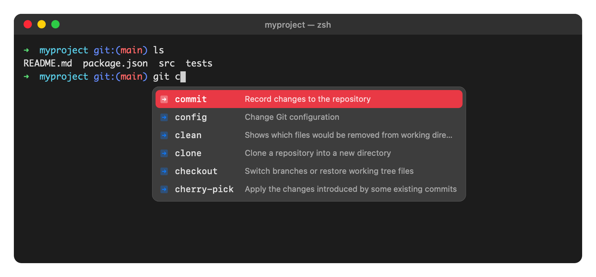

# Termsuggest

This is a simple alternative to the terminal autocomplete that started as Fig, then became
Amazon Q, and later Kiro CLI. Kiro CLI dropped this feature, so I vibe-coded a replacement
with Claude Code.

Use it at your own risk. It is completely vibe-coded, so your machine might explode.



## What it does

While you type a command in zsh, a small window appears below your cursor with suggestions:

- `git ` shows git subcommands, `git push ` shows your remotes, and `git checkout ` shows your branches.
- `cd ` shows folders, with the ones you used most recently at the top.
- `npm run ` shows the scripts from your `package.json`, `php artisan ` shows Artisan commands, and so on.
- Typing `-` shows the options of the current command.

It knows about 700 commands, thanks to the open-source
[Fig completion specs](https://github.com/withfig/autocomplete) (MIT). It remembers what you
use, so your most recent choices float to the top.

## Keys

| Key       | Action |
|-----------|--------|
| ↑ / ↓     | Move through the suggestions |
| Tab       | Insert the selected suggestion |
| Enter     | Insert the suggestion if you used ↑/↓, otherwise run the command as usual |
| Esc       | Hide the suggestions until you type again |
| Mouse     | Click a suggestion to insert it |

When no suggestions are shown, all keys work as they normally do in zsh.

## Requirements

- macOS with zsh (the default shell)
- [Node.js](https://nodejs.org) 20 or newer (for example `brew install node`)
- Xcode Command Line Tools for the floating window (`xcode-select --install`).
  Without them, the suggestions are shown inside the terminal instead.

## Installation

```sh
git clone https://github.com/FinnPaes/termsuggest.git ~/termsuggest
~/termsuggest/install.sh
```

Then open a new terminal tab and start typing.

The first time the window appears, macOS asks for **Accessibility** access for
TermSuggest. Allow it (System Settings → Privacy & Security → Accessibility) so that the
window is placed exactly below your cursor. Without it, the position is estimated.

To update, run `git pull` in the folder and then `./install.sh` again.

## Commands

```sh
termsuggest status    # is it running?
termsuggest restart   # restart the background process
termsuggest off       # turn it off in this terminal (termsuggest on to turn it back on)
```

## Settings

Put these in `~/.zshrc` **before** the `source …/termsuggest.zsh` line:

```sh
TERMSUGGEST_UI=inline          # show suggestions inside the terminal instead of a window
TERMSUGGEST_ENTER=always       # Enter always inserts the suggestion (navigated | always | never)
TERMSUGGEST_MAX_ROWS=8         # number of visible rows (inline mode)
TERMSUGGEST_SHOW_HIDDEN=1      # also show dotfiles without typing a "."
```

## Uninstall

Remove the `source …/termsuggest.zsh` line from `~/.zshrc`, run `termsuggest stop`, and
delete the folder. Your usage history is in `~/.local/share/termsuggest`.

## How it works

- `termsuggest.zsh` is the zsh plugin. It sends what you type to a background process and
  handles the keys.
- `src/` is a small Node.js process that reads the completion specs, runs things like
  `git branch` to get live suggestions, and ranks the results.
- `overlay/` is a tiny native macOS app that draws the floating window.
- `specs/` contains the Fig completion specs, already compiled. To rebuild them from source,
  clone [withfig/autocomplete](https://github.com/withfig/autocomplete) into
  `vendor/fig-autocomplete` and run `npm install && npm run build-specs`.

Note: some suggestions are produced by running commands in your current folder (for
example `git branch`), just like Fig did.
